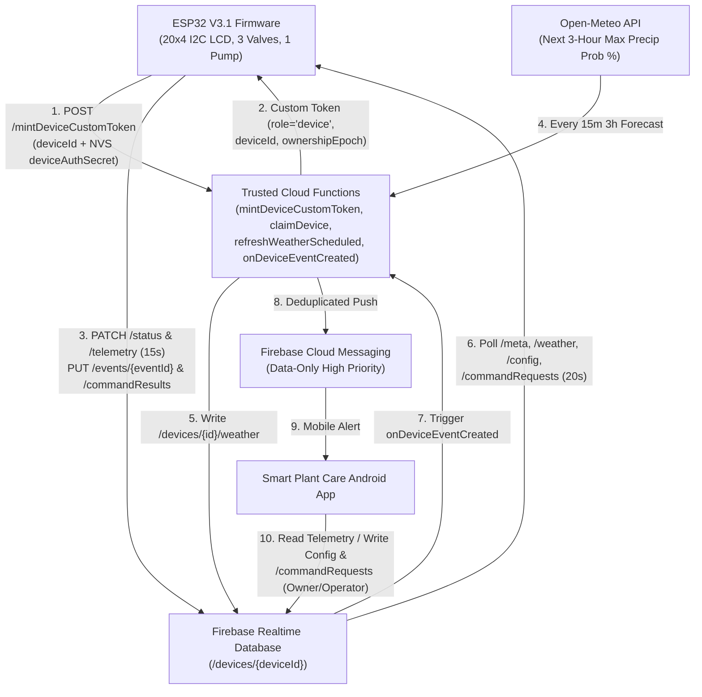

# ESP32 & FIREBASE INTEGRATION GUIDE — Smart Plant Care (V3.1 I2C Edition)

This document details the runtime protocol between the **ESP32 V3.1 Firmware** (`esp32_firmware/SmartPlantCare/`), **Firebase Realtime Database**, **Firebase Cloud Functions** (`firebase_backend/`), **Open-Meteo Weather API**, and the **Android Application**.

---

## 1. End-to-End Architecture & Data Flow



---

## 2. Device Authentication & Ownership Epoch Lifecycle (Phases 8, 9, 10)

### 2.1 Zero-Hardcoded-Admin-Key Authentication
1. On boot (and every 50 minutes before token expiry), `FirebaseClientManager` sends `POST /mintDeviceCustomToken` with:
   ```json
   {
     "deviceId": "spc-unit-0001",
     "deviceAuthSecret": "<per-board-NVS-secret>",
     "bootId": "b4A1F-120",
     "firmwareVersion": "3.1.0-i2c"
   }
   ```
2. The Cloud Function verifies `sha256(deviceAuthSecret)` against `/deviceSecrets/{deviceId}/deviceAuthSecretSha256`, reads `/devices/{deviceId}/meta`, and mints a custom token with claims:
   ```json
   {
     "role": "device",
     "deviceId": "spc-unit-0001",
     "ownershipEpoch": 1
   }
   ```
3. The ESP32 exchanges `customToken` with `https://identitytoolkit.googleapis.com/v1/accounts:signInWithCustomToken?key=<WEB_API_KEY>` to obtain a standard Firebase `idToken`.

### 2.2 First-Time Physical Claim (`claimDevice`)
1. The Android user provisions Wi-Fi to the ESP32 and calls the `claimDevice` Cloud Function with `{ deviceId, claimCode, displayName, lat, lon }`.
2. `claimDevice` verifies `sha256(claimCode)` against `/deviceSecrets/{deviceId}/claimCodeSha256`, increments `/devices/{deviceId}/meta/ownershipEpoch`, sets `ownershipState = "OWNED"`, and grants `role = "owner"` under `/devices/{deviceId}/acl/members/{uid}`.
3. On the next `/meta` poll, the ESP32 detects the transition to `OWNED`:
   - Persists `ownershipState = OWNED` and `ownershipEpoch` in NVS.
   - Plays **1 short beep (`150 ms`)** on `GPIO18` (`BuzzerEventId::PAIRING_SUCCESS`).
   - Displays the 5-second **`DEVICE PAIRED`** overlay on the 20×4 I2C LCD.

### 2.3 Multi-User Device Sharing (`owner`, `operator`, `viewer`)
- **Owner (`owner`)**: Full control, threshold configuration, manual watering, sharing (`createShareInvite`, `revokeMemberAccess`), and `unclaimDevice`.
- **Operator (`operator`)**: Can view all telemetry, update thresholds (`/config`), and trigger manual watering (`/commandRequests`). Cannot manage ACL or unclaim the device.
- **Viewer (`viewer`)**: Read-only access to `/status`, `/telemetry`, `/weather`, `/config`, and `/events`, plus receives FCM push notifications.

### 2.4 Unclaim & Account Deletion (`RESET_PENDING` Durable Reset)
When the owner calls `unclaimDevice` OR deletes their account (`deleteMyAccountAndReleaseDevices`):
1. The Cloud Function atomically increments `ownershipEpoch`, sets `/devices/{deviceId}/meta/ownershipState = "RESET_PENDING"` and `resetRequired = true`, wipes `/acl`, `/commandRequests`, `/events`, and `/notificationOutbox/{deviceId}`, and removes `/users/{memberUid}/devices/{deviceId}` for all shared members.
2. When the ESP32 sees `RESET_PENDING` (or `resetRequired == true`):
   - **Immediate Hardware Cutoff**: Calls `relays.emergencyAllOff()`, `irrigation.triggerEmergencyStop("RESET_PENDING")`, `buzzer.stopImmediately()`, and `events.clearAllForReset()`.
   - **Durable NVS Checkpoint**: Writes `rstPending = true` to NVS **before** clearing local user state so a power loss mid-reset cannot leave stale user state active.
   - **Preserves Physical Calibration**: Keeps `dryRaw`, `wetRaw`, `reservoirFullGapIn`, and `reservoirEmptyGapIn` in NVS while resetting user thresholds to defaults.
   - **Acknowledges Reset**: Sends `POST /acknowledgeDeviceReset` to the backend, which transitions `/devices/{deviceId}/meta/ownershipState` from `"RESET_PENDING"` to `"UNCLAIMED"`.

---

## 3. Open-Meteo Weather & Strict Rain Suspension Contract (Phase 3D)

### 3.1 Cloud Weather Contract (`/devices/{deviceId}/weather`)
Every 15 minutes, `refreshWeatherScheduled` queries Open-Meteo for the next 3 hours (`forecast_hours=3&hourly=precipitation_probability`) and writes the **maximum** hourly probability across the 3-hour window:
```json
{
  "provider": "open-meteo",
  "valid": true,
  "rainProbabilityPct": 75,
  "windowHours": 3,
  "windowLabel": "NEXT 3 H",
  "fetchedAt": 1730966400000,
  "validUntil": 1730970000000
}
```

### 3.2 Authoritative Rain Suspension Evaluation on ESP32
`RainWeatherManager::evaluateRainGate()` implements the exact confirmed AND-condition:
```cpp
const bool shouldTriggerRainSuspension =
    outdoorMode
    && weatherDataValid
    && weatherDataFresh
    && (rainProbability >= rainThresholdPct) // Default 60%
    && rainSensorWetConfirmed;               // Sustained wet >= 30,000 ms
```
- **Forecast ≥ 60% + Dry Rain Sensor**: Sets `status.weatherAdvisoryActive = true`, emits a single `WEATHER_RAIN_WARNING` event, keeps the buzzer **SILENT**, and does **not** trigger rain suspension.
- **Wet Rain Sensor + Forecast < 60%**: Updates live `rainRawWet = true` telemetry, keeps the buzzer **SILENT**, and does **not** trigger a new rain suspension.
- **Both Satisfied (`shouldTriggerRainSuspension == true`)**: Latches `rainSuspensionLatched = true`, stops any active watering (`Pump OFF -> 250ms -> Valve OFF`), sounds **2 short beeps (`2 × 150 ms`)** once, and emits a single `RAIN_SUSPENSION_STARTED` event.
- **Latch Recovery**: Remains latched until `rainSensor` is continuously dry for `>= 120,000 ms` **AND** fresh valid weather reports `rainProbability < 60%` (or mode is switched to `INDOOR`).

---

## 4. Remote Command Protocol (`/devices/{deviceId}/commandRequests/{cmdId}`)

To request manual watering or emergency stop from the Android app (`owner` or `operator`), write a new child under `/devices/{deviceId}/commandRequests/{cmdId}`:
```json
{
  "type": "WATER_CROP",
  "crop": "tomato",
  "durationMs": 4000,
  "state": "PENDING",
  "requestedByUid": "<current_user_uid>",
  "ownershipEpoch": 1,
  "createdAt": 1730966450000,
  "expiresAt": 1730966510000
}
```
The ESP32 validates `ownershipEpoch`, checks `expiresAt` (`<= 60s` TTL), checks the 12-slot processed-command ring buffer, verifies all hardware safety gates (reservoir not critical/empty/invalid, no emergency stop, no active outdoor rain suspension), executes the single-valve + pump pulse, and writes the result to `/devices/{deviceId}/commandResults/{cmdId}`.
